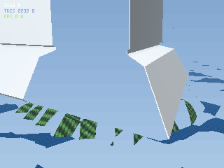
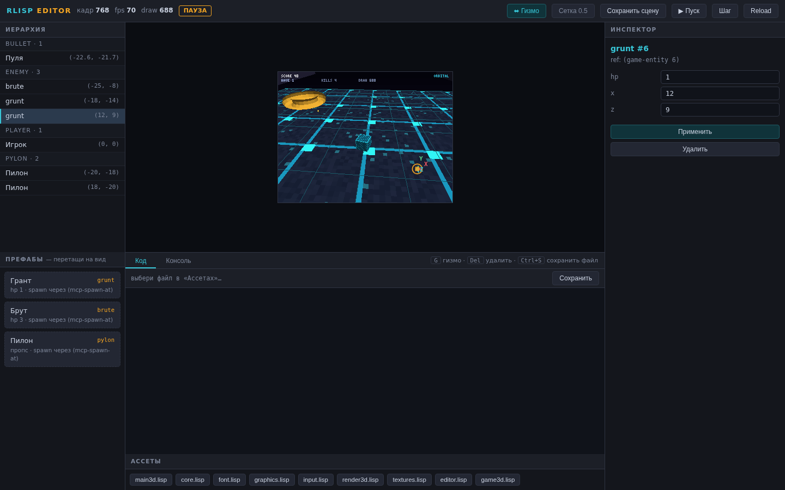

<div align="center">


# rlisp-engine

**A game engine where the game is a Lisp file and Rust is only the hardware layer.**

[Website](https://kostyk348.github.io/rlisp-engine/) · [Playground](https://kostyk348.github.io/rlisp-engine/playground.html) · [Roadmap](docs/roadmap.md) · [Русский](README.md)

[](https://github.com/kostyk348/rlisp-engine/actions/workflows/ci.yml)
[](https://github.com/kostyk348/rlisp-engine/releases)





</div>

---

## What it is

**24,353 lines of Rust** are the HAL: rasterizer, T&L, z-buffer, input, time, audio, PNG,
HTTP. Everything else is **8,695 lines of Lisp**: `update`/`draw`, physics, ECS, input,
textures, post-processing, the scene editor itself and every demo game.

```lisp
(define (update dt)
  (poll-input)
  (when (key-down? "w") (set! *z* (+ *z* (* 4.0 dt))))
  (for-each (lambda (e) (enemy-step e dt)) *enemies*))

(define (draw)
  (gpu3d-clear 0.08 0.09 0.12)
  (gpu3d-batch-mat *wall-mesh* *instances* mvp)
  (gpu-present))
```

Four properties follow, and each one is checked rather than advertised:

| Property | How it is verified |
|---|---|
| **Hot reload without restart** | edit a `.lisp` file — the engine rebuilds its environment on the next frame, persistent values survive |
| **A run replays bit-for-bit** | `--record` / `--replay`: per-frame hash, hash chain, the exact frame that diverged |
| **Zero dependencies** | the default build pulls no crates at all; CI enforces it (`cargo tree`) |
| **The whole engine in ~1.2 MB of WASM** (1,242,983 bytes) | `docs/playground.html` — editor, REPL and audio in the browser, offline |

## Why this is not a Lisp toy

Numbers from real runs (`docs/benchmark.md` has the environment and method):

| What | Result | Conditions |
|---|---|---|
| JIT of a numeric kernel (lambda with `if`/`+`/`*`/`/`) | **49.07×** over the interpreter (2296 → 47 ns/call) | 200,000 calls, release + `--features jit` |
| SIMD `vec-dot`, 2048 f32 | **4.22×** over scalar (22.8 → 5.4 ms) | `--bench`, SSE2 path |
| Batched vector math vs per-element Lisp | **~1107×** | 400-body integration, 20,000 iterations |
| 320×240 2D frame, software raster | **0.38 ms** pure HAL / **0.65 ms** through Lisp | `--bench`: 120 rects + 12 blits + 4 textures |
| A whole game in Lisp | **714 lines** (RUINER), **745** (OASIS) | `assets/lisp/` |

Quality is held by tests, not by promises: **143/143** (`cargo test --workspace`), clippy with
`-D warnings`, `cargo fmt --check`, plus a home-grown linter that keeps `src/` files under
800 lines (see [AI_AGENTS.md](AI_AGENTS.md)).

## Quick start

```bash
git clone https://github.com/kostyk348/rlisp-engine && cd rlisp-engine

cargo run --release                                   # "Survival" demo (all game code in assets/lisp/)
cargo run --release -- --script assets/lisp/main_ruiner.lisp --ascii --stdin-keys   # DOOM-like in a terminal
cargo run --release -- --serve                        # editor: http://127.0.0.1:7300
cargo run --release -- --script assets/lisp/main3d.lisp --capture demo/frames --fast --frames 300
```

The default build has no dependencies. `--features wgpu` adds the wgpu backend,
`--features jit` enables the copy-and-patch JIT.

## Determinism: a run replays bit-for-bit

Rare for a game engine: **every frame has a hash, frames are chained**, and any run can be
recorded and later verified frame by frame.

```bash
# record: RNG seed + per-frame input + the hash of every frame
cargo run --release -- --script assets/lisp/replay_demo.lisp \
    --fast --frames 240 --record saves/demo.rlrp

# replay: the same frames and the same chain — or the exact frame that diverged
cargo run --release -- --script assets/lisp/replay_demo.lisp \
    --fast --frames 240 --replay saves/demo.rlrp
# => replay replay: 240 из 240 кадров сверено, chain 883cd568c4599f32, OK
```

- **the frame hash is FNV-1a over the framebuffer bytes** — what is verified is what the
  player actually saw, pixels included, not an abstract "world model";
- **a chain instead of a single hash**: `chain_{n+1} = mix(chain_n, frame, hash)`, so one
  diverging frame breaks every hash after it and the first mismatch is named explicitly
  (exit code 1 — usable in CI);
- **live recording from the editor at any frame**: the "Determinism" panel in the console
  (`● Record / ■ Stop`) or `(replay-record! "saves/live.rlrp")`; the file keeps `start N`
  and replay verifies from that frame on;
- **randomness only through `(random-seed n)` / `(random-int a b)` / `(random-range a b)`**,
  so determinism holds by construction.

The run file is plain text (`RLISP-REPLAY 1`, `seed`, `fps`, `frames`, `start`, per-frame
`frame hash input…`, final `chain`): tens of KB for thousands of frames, diffable, and
attachable to a bug report.

## What it can do

| Subsystem | What is there |
|---|---|
| **3D** | T&L in Lisp, z-buffer, vertex batching (`gpu3d-batch-mat`), LUT fog, materials, skeletal animation |
| **Lighting & post** | directional light + point lights, blob shadows, bloom with an exposure shoulder, vignette, grain |
| **Physics** | impulse solver, NGS rolling friction, spheres/polygons/heightfield, buoyancy, angular dynamics |
| **ECS** | slots + generations (zombie handles are impossible), bulk iteration `ecs-each` / `ecs-col` |
| **2D rendering** | from-scratch PNG decoder, procedural textures in Lisp, alpha test/blend, billboard sprites |
| **Audio** | mixing, synthesis (saw/noise/sine), 3D attenuation, SFX synth inside the editor |
| **Assets** | named registry with types and refcounts, explicit `asset-gc!` |
| **Scripting** | 224 natives; everything else is Lisp libraries with hot reload |
| **Build** | native binary + WASM (`scripts/export_game.py` — a self-contained single-page HTML) |
| **AI** | MCP server (`--mcp`, JSON-RPC 2.0 stdio): scene, spawning, properties, simulation step, frames |

## Editor (--serve)

`cargo run --release -- --serve` → `http://127.0.0.1:7300`: scene hierarchy, property
inspector, live view (PNG frame stream), X/Y/Z gizmos inside the running game, prefab
drag-and-drop, "save scene" into a `.lisp` file, REPL, code editor with hot reload, and a
run-recording panel. The UI is `assets/editor/index.html`; scene semantics live in
`assets/lisp/editor.lisp` (the server knows nothing about the game).

## AI Ready: MCP

`--mcp` starts an MCP server: an agent sees the scene, spawns entities, edits properties,
evaluates Lisp, steps the simulation and receives frames. Agent rules are in
[AI_AGENTS.md](AI_AGENTS.md): modularity, an 800-line-per-file limit, a CI check.

## Architecture

```
┌──────────────────────────────────────────────────────────────┐
│ L4  Games in Lisp: RUINER · OASIS · SHTOLNYA · DOLINA · Island│
├──────────────────────────────────────────────────────────────┤
│ L3  System DSLs (assets/lisp/): graphics · input · ECS ·      │
│     physics · render3d · textures · audio · scene editor      │
├──────────────────────────────────────────────────────────────┤
│ L2  Interpreter: cons + Vec, tracing GC, JIT, SIMD scanner    │
├──────────────────────────────────────────────────────────────┤
│ L1  HAL (Rust): raster, T&L, z-buffer, fb, time, input, audio, │
│     PNG, HTTP/editor, MCP, wgpu backend behind a facade       │
└──────────────────────────────────────────────────────────────┘
```

More: [docs/architecture.md](docs/architecture.md).

## Honest limitations

- **wgpu covers 2D only**; the 3D pipeline is software (moving it is a separate stage);
- **determinism is guaranteed at a fixed dt** (`--fast` / `--frames` / `--input`); in
  real time dt floats and recording warns about it at start;
- **no node tree like Godot**: the scene is ECS + Lisp structures, a deliberate choice;
- **no animation or shader editor**; animation is data in Lisp;
- MSRV is rustc 1.83; `--features jit` builds on x86-64 Linux only.

Full list: [LIMITATIONS.md](LIMITATIONS.md).

## Layout

```
src/            Rust HAL and core: hal/ · interp/ · render3d/ · physics/ · gpu/ · jit/ · replay.rs · editor.rs
assets/lisp/    all logic: core · input · graphics · ecs · physics · render3d · editor · games
assets/editor/  editor UI (index.html, zero dependencies)
docs/           architecture, benchmarks, roadmap, history, website, playground
scripts/        HTML game export, checks, benchmarks
```

## Documentation

[Architecture](docs/architecture.md) · [Benchmarks](docs/benchmark.md) · [Roadmap](docs/roadmap.md) · [Project history](docs/history.en.md) · [Limitations](LIMITATIONS.md) · [CHANGELOG](CHANGELOG.md) · [Agent rules](AI_AGENTS.md)

## Contributing

Issues for bugs and ideas; pull requests are welcome — see [CONTRIBUTING.md](CONTRIBUTING.md)
and the rules in [AI_AGENTS.md](AI_AGENTS.md) (files ≤ 800 lines, green tests, clippy clean).
Discussion happens in [Discussions](https://github.com/kostyk348/rlisp-engine/discussions).

## License

[MIT](LICENSE).
