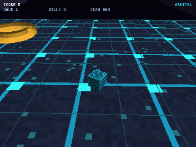
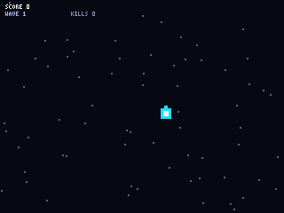
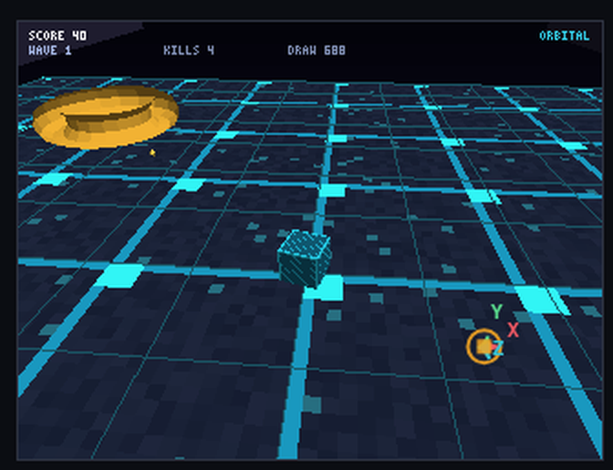
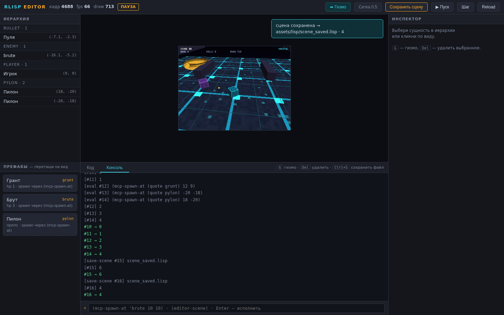

# rlisp-engine

[](https://github.com/kostyk348/rlisp-engine/actions/workflows/ci.yml)
[](https://github.com/kostyk348/rlisp-engine/actions/workflows/pages.yml)
English | [Русский](README.md)

**A game engine as a Lisp machine: Rust is only the HAL, everything else is a DSL.**

A prototype per [the spec v1.0](#): the engine contains no game systems — it only
exposes access to "the hardware". The renderer, physics, ECS, input, textures,
editor and MCP are Lisp libraries on top of a thin Rust layer.

**v0.3 — textures, batch renderer, Unity-style editor, AI Ready/MCP:**

- **Textures**: a dependency-free PNG decoder (full inflate: stored/fixed/dynamic
  Huffman), procedural textures in Lisp (a canvas over F32Vec), perspective-correct
  UV sampling (interpolation of `u/w` and `1/w`, attribute clipping together with the vertex);
- **Batch renderer**: hundreds of objects in a single draw call — 12 f32 per instance
  (translate/scale/yaw/pitch/roll/tint), T&L of all instances in a tight Rust loop —
  a **~3× speedup** over per-object draw calls;
- **Unity-style editor** (`--serve`): scene hierarchy, property inspector, live
  view (PNG frame stream), REPL, asset code editor with hot reload — all UI
  talks to the engine through Lisp (`editor.lisp`);
- **AI Ready / MCP** (`--mcp`): Model Context Protocol (JSON-RPC 2.0, stdio) —
  an AI agent sees the scene, spawns entities, edits properties, runs Lisp,
  steps the simulation and **receives engine screenshots**.

**v0.4 (roadmap stages 3/5/6):** copy-and-patch JIT for numeric kernels (49×,
zero-dep) + SIMD tokenizer; fresh demo gifs and benchmark.md; the editor became
a real editor: **X/Y/Z gizmos move entities in the live game, prefab
drag-n-drop, "Save scene" into a Lisp file** (the editor page was rebuilt —
on master it had been broken since the first commit).

```
┌──────────────────────────────────────────────────────────────────────┐
│  LAYER 4: Game DSLs (genre-level)                                    │
│  (defgame survival …) (defenemy grunt …)       «ORBITAL» (game3d.lisp)│
├──────────────────────────────────────────────────────────────────────┤
│  LAYER 3: System DSLs — everything in Lisp (assets/lisp/)            │
│  graphics │ input │ ecs │ physics │ render3d │ textures │ editor     │
├──────────────────────────────────────────────────────────────────────┤
│  LAYER 2: Lisp interpreter + SAL (src/interp.rs, src/simd.rs)        │
│  Reader │ Evaluator (TCO) │ defmacro/quasiquote │ F32Vec │ GC        │
├──────────────────────────────────────────────────────────────────────┤
│  LAYER 1: Rust HAL (src/hal.rs, render3d.rs, png.rs, editor.rs,      │
│  mcp.rs, json.rs) — window/raster │ 3D "GPU": T&L+textures+batches+  │
│  z-buffer │ input │ memory │ time │ PNG codec │ HTTP │ MCP           │
└──────────────────────────────────────────────────────────────────────┘
```

## Quickstart

```bash
cargo build --release

# 3D demo «ORBITAL» (no screen needed — PNG frames):
./target/release/rlisp-engine --script assets/lisp/main3d.lisp \
    --capture demo/frames3d --every 12 --frames 240 --fast

# play 3D in the terminal (ANSI, wasd, q — quit):
./target/release/rlisp-engine --script assets/lisp/main3d.lisp --ascii --stdin-keys

# UNITY-STYLE EDITOR (browser): hierarchy · inspector · view · REPL · assets
./target/release/rlisp-engine --serve --port 7300 --script assets/lisp/main3d.lisp
#   → open http://127.0.0.1:7300
bash scripts/demo_editor.sh          # the same, one command

# AI READY: MCP server (JSON-RPC 2.0 over stdio) — plug in any AI agent
./target/release/rlisp-engine --mcp --script assets/lisp/main3d.lisp

# 2D demo «Survival»:
./target/release/rlisp-engine --ascii --stdin-keys

# SIMD-layer benchmark: ./target/release/rlisp-engine --bench
# self-checks (TCO, macros, textures, batches, PNG codec): bash scripts/smoke.sh

# HOT RELOAD DEMO: at t=9s the script edits game3d.lisp on the fly:
bash scripts/demo3d.sh   # → demo/orbital.gif + demo/filmstrip3d.png
```

## Render backends (roadmap stage 1)

Behind the HAL facade there are two backends with one API profile (`gpu-clear` /
`gpu-fill-rect` / `gpu-blit` / `gpu-blit-tex` / `gpu-present`); the Lisp code
is identical for both:

| Backend | How to enable | What it does |
|---|---|---|
| **software raster** (default) | nothing; zero dependencies | commands write straight into the framebuffer |
| **wgpu** | `cargo build --release --features wgpu` + the `--wgpu` flag | offscreen RGBA8 render (WGSL shader, nearest, discard alpha=0) → map-read → composite into the framebuffer; without an adapter — a warning and a fallback to software |

Frame benchmark: `--bench` (software) and `--bench --wgpu` (GPU, with a
submit/readback split). Honestly: wgpu covers the 2D raster; the 3D pipeline
(T&L, z-buffer, batches) is still software; the "wgpu is much faster" criterion
requires GPU hardware — `docs/benchmark.md` contains only real measurements
with environment labels. Details in `docs/architecture.md`; roadmap in
`docs/roadmap.md`.

## Interpreter: cons pairs, tracing GC, background MCP (roadmap stage 2)

**Stage criteria — verified** (tests + `scripts/smoke.sh`):

| Criterion | How it is verified |
|---|---|
| `(cons 1 2)` | → `(1 . 2)`: unit test, smoke line, `--eval`; `car`/`cdr`/`set-car!`/`set-cdr!`/`cons?`/`pair?`/`list?`/`length`/`append`/`reverse`/`nth`/`apply` work with both pairs and Vec lists; printing is standard `(a b c)` / `(a . b)`, cycles print as `(1 …)` without hanging |
| 1000 closure cycles | a test runs 1000 iterations of "build a pair of closures capturing each other through the environment → drop the root → collect": live objects in the GC heap equal the baseline on every iteration (≥ 3000 objects freed) |
| MCP does not crash the game | hammer test: 120 tools (eval/spawn/step/screenshot/…) from a background thread on top of the live 3D game — all answered, zero panics; smoke: 102 requests over stdio |

- **Pairs**: `cons` builds a cons cell (`Value::Cons`); Vec lists are still
  there — the representations coexist; the reader accepts `(a . b)` and
  `(lambda (a . rest) …)`, quasiquote traverses pairs.
- **GC**: tracing mark-sweep (`src/gc.rs`, zero dependencies) for pairs,
  closures and environments — an object arena, handles (index + generation)
  inside `Value`, marking from roots (the global environment, pin sets, the
  input queue). Collection happens at form boundaries; `(gc)` requests a
  collection, `(gc-stats)` shows the counters. Rc containers (vectors,
  tables, strings) stay on Rc and are transparent to marking; closure↔environment
  cycles and pair cycles are collected, Rc cycles through the containers
  themselves are not (yet) — honestly stated in `LIMITATIONS.md`.
- **Threads**: MCP is served by background threads — a reader parses stdio
  into an mpsc channel, the game thread (the sole owner of the interpreter)
  applies requests between frames, a single writer prints the answers. Threads
  communicate only via channels — no data races by construction; `--mcp`
  behavior is unchanged.

## Demos

3D «ORBITAL» (v0.3): the floor is a procedural "neon circuit" texture (one
textured draw call instead of hundreds of lines), enemies/player are a "panel"
texture with tint; enemies/bullets/pylons are drawn in **batches** (one draw
call per group). At t=9s `game3d.lisp` is edited on disk: enemies turn orange
and twice as fast — without a restart (`demo/run3d.log`, "12 persistent values
restored"). The gifs were re-captured on the current master (stage 5): 90
frames / 18 s, 540 frames of simulation without a single crash.



2D «Survival» (v0.1, fresh stage-5 capture): 

All game code is Lisp (`assets/lisp/game.lisp`, `assets/lisp/game3d.lisp`):
player, waves, aim assist, collisions, score, GAME OVER + restart on `R`.

## Unity-style editor (--serve)

Zero dependencies: an HTTP server on `std::net`, the editor page is embedded
in the binary (`assets/editor/index.html`). The game thread publishes the
frame/scene/log into a bridge (`src/editor.rs`); the browser polls `/api/state`
and `/frame.png`.


| Panel | What it does |
|---|---|
| **Hierarchy** | live list of scene entities — player, enemies, pylons, bullets, effects; click to select (clicking the view works too) |
| **Prefabs (stage 6)** | chips from the game hook `(prefab-list)` (grunt / brute / pylon); **drag-n-drop onto the view** → pixel ray-unproject → `(mcp-spawn-at 'kind x z)` — spawns into the live game |
| **Inspector** | properties of the selected entity; "Apply" runs `(table-set! REF 'prop value)` in the live world |
| **View** | engine frame as a PNG stream (~5 Hz), **X/Y/Z gizmo (stage 6)**: dragging an axis moves the entity in the live game; 0.5 grid-snap toggle, PAUSE badge |
| **Console + REPL** | any Lisp in the live environment: `(mcp-spawn-at 'brute 10 10)`, `(load "scene_saved.lisp")` → answer in the console |
| **Code** | assets (all .lisp files), edit, Ctrl+S → `/api/save` → **the engine hot-reloads itself**, persistent state is carried over |
| **Toolbar** | pause/step frame/reload Lisp, frame, fps, triangles, **«Save scene» (stage 6)**, hotkeys: `G` — gizmo, `Del` — delete selection |

### Saving the scene as Lisp (stage 6)

The "Save scene" button → `POST /api/save-scene` → the game thread calls
`(editor-save-scene "scene_saved.lisp")` (editor.lisp) and serializes the
live scene into restore forms:

```lisp
;; scene_saved.lisp — scene saved by the rlisp-engine editor.
(begin (table-set! *player* 'x 0.0) (table-set! *player* 'z 0.0))
(mcp-spawn-at 'grunt -18 -14)
(mcp-spawn-at 'brute -25 -8)
(mcp-spawn-at 'pylon 18 -20)
```

To restore in the game: `(load "scene_saved.lisp")` via the REPL. The
round-trip is covered by a unit test: 3 entities → file → reader → load →
same entities and positions.




The API (the same one any script/agent uses):

```
GET  /                 editor page             GET  /frame.png      current frame
GET  /api/state        scene+log+results       GET  /api/file?path= asset text
                       + game camera & prefabs
                       (editor-camera /
                       prefab-list hooks, stage 6)
POST /api/eval {code}  evaluate Lisp           POST /api/save       save an asset
POST /api/key {key,down} key into the game     POST /api/ctl {cmd}  pause|resume|step|reload
POST /api/save-scene {path} serialize the scene into a Lisp file (stage 6)
```

The hierarchy's scene is Lisp: `(editor-scene)` (editor.lisp) calls the game
hook `(scene-entities)` (game3d.lisp) — tables become JSON natively
(`src/json.rs`, HAL layer). The gizmo camera and prefabs work the same way:
hooks `(editor-camera)` and `(prefab-list)`; no hook — the editor honestly
hides the tool.

## AI Ready: MCP (--mcp)

Model Context Protocol, JSON-RPC 2.0 over stdio — the standard for AI tooling
(Claude Desktop, any MCP clients). The protocol plumbing is Rust (`src/mcp.rs`);
the tool semantics are Lisp (editor.lisp + game hooks).

| Tool | What it does |
|---|---|
| `status` | frames, fps, score, wave, enemies, draw calls, SIMD level |
| `scene_get` | scene as JSON: player/enemies/bullets with coordinates |
| `lisp_eval` | **full access**: any Lisp code in the live environment |
| `entity_spawn` / `entity_set` / `entity_remove` | entity operations |
| `step {frames}` | step the simulation (up to 600 frames) |
| `screenshot` | **frame PNG (base64, image content)** — the agent sees the game |
| `hot_reload` | re-read .lisp (defpersistent state is carried over) |
| `key` | keyboard event |

Example session:

```
→ {"jsonrpc":"2.0","id":1,"method":"initialize","params":{}}
← {"result":{"protocolVersion":"2024-11-05","serverInfo":{"name":"rlisp-engine","version":"0.3.0"}}}
→ {"id":2,"method":"tools/call","params":{"name":"step","arguments":{"frames":90}}}
← {"result":{"content":[{"text":"выполнено 90 кадров (102.9 fps headless)"}]}}
→ {"id":3,"method":"tools/call","params":{"name":"screenshot"}}
← {"result":{"content":[{"type":"image","data":"iVBORw0KGgo…","mimeType":"image/png"}]}}
```

## 3D pipeline (v0.2 → v0.3)

The division of labor is the same as between a CPU and a GPU:

| Layer | What it does |
|---|---|
| **Rust `render3d.rs`** ("hardware", fixed-function) | T&L (model·view·proj), Sutherland–Hodgman clipping at the near plane **together with UV attributes**, backface cull, rasterization with a z-buffer, flat Lambert shading, **texturing: perspective-correct UV** (`u/w`, `1/w` — affine in screen space), **batching: instances are expanded into shared buffers + a single rasterization pass**, DDA lines |
| **Lisp `render3d.lisp`** (pipeline) | 4×4 matrices, `mat-lookat`, `mat-perspective`, models, primitives (cube/UV sphere/torus/octahedron/plane), `camera-mvp`, `draw-mesh`, **`draw-batch`/`draw-batch-tex`, `inst-row` (12 f32: t·s·yaw·pitch·roll·tint)** |
| **Lisp `textures.lisp`** (v0.3) | `tex-canvas`/`tex-px!` — procedural textures (`tex-circuit`, `tex-panel`, `tex-checker`, `tex-noise`, `tex-gradient`), `load-texture` (PNG), UV mappings of the primitives, 2D `draw-sprite` |
| **Lisp `game3d.lisp`** (scene/game) | camera behind the player, spawning, chasing, bullets, FX, HUD, editor hooks |

3D HAL natives — "raw GPU commands":

| Native | Signature |
|---|---|
| `gpu3d-clear` | `(gpu3d-clear r g b)` |
| `gpu3d-light` | `(gpu3d-light dx dy dz ambient [diffuse [spec [shininess]]])` — optional specular (stage 7) |
| `gpu3d-mesh` | `(gpu3d-mesh pos idx model mvp r g b)` |
| `gpu3d-mesh-tex` | `(gpu3d-mesh-tex pos uv idx tex model mvp r g b)` |
| `gpu3d-batch` | `(gpu3d-batch pos idx insts mvp)` — instances: 12 f32 |
| `gpu3d-batch-tex` | `(gpu3d-batch-tex pos uv idx tex insts mvp)` |
| `gpu3d-alpha-test` | `(gpu3d-alpha-test threshold)` — cutout, 0 = off (stage 7) |
| `gpu3d-mat-tiling` | `(gpu3d-mat-tiling u v)` — UV repeat (stage 7) |
| `gpu3d-fog` | `(gpu3d-fog r g b density)` — exp fog by depth (stage 7) |
| `gpu3d-view` | `(gpu3d-view x y z)` — camera for specular (stage 7) |
| `gpu3d-state` | `(gpu3d-state)` — pipeline state table (stage 7) |
| `gpu3d-wire` | `(gpu3d-wire pos pairs model mvp r g b)` |
| `gpu3d-stats` | `(gpu3d-stats)` → `(drawn culled)` |

Texture HAL: `texture-load` (PNG from disk), `texture-upload` (RGBA from a
Lisp buffer), `texture-size`, `texture-pixels`, `texture-free`, `gpu-blit-tex`
(2D sprite with tint). The PNG codec (`src/png.rs`) is hand-written: a writer
(stored deflate) + a **reader** (full RFC 1951 inflate + filters 0–4, color
types 0/2/3/4/6).

One «ORBITAL» v0.3 frame ≈ **7–9 3D draw calls** (v0.2: 60–80), ~700–800
triangles, 320×240 — **~100 fps** headless on the test VM (the frame uses the
textured raster — costlier per pixel than flat). Batch measurement: 30 cubes ×
60 repeats — **batch 13.0 ms vs 39.5 ms per-object (3.0×)**.

## Materials, lighting, fog (stage 7)

The software 3D "GPU" gained fixed-function-style materials — the render
foundation for the upcoming showcase scene (materials/water/trees):

- **alpha test (cutout)** — `(gpu3d-alpha-test 0.4)`: a texel below the
  threshold is discarded **before the z-write**, so the scene is visible
  through grass blades and fence holes; there is no 3D alpha blending
  (honestly documented);
- **Blinn-Phong specular** — `(gpu3d-light dx dy dz ambient diffuse 0.6 48)`
  plus `(gpu3d-view x y z)`: per-pixel half-vector on a perspective-correct
  world position; spec 0 keeps the plain Lambert path;
- **tiling** — `(gpu3d-mat-tiling 16 16)`: fract-repeat (ground/walls
  without stretching);
- **fog** — `(gpu3d-fog 0.55 0.7 0.9 0.045)`:
  `1 - exp(-density · depth)` on true depth (1/w), mixed after shading;
- **materials in Lisp** (`assets/lisp/materials.lisp`, loaded by main3d):

```lisp
(defmaterial 'bushes ':texture tex ':alpha-test 0.4 ':spec 0.6 ':shininess 48)
(draw-batch-tex mesh uv tex insts mvp 'bushes)  ; material as the last argument
(material-reset!)                               ; neutral state
```

Visual proof — `bash scripts/materials_proof.sh` (4 variants of one scene,
PIL pixel check): see `demo/stage7-materials.png`. Cost of the features,
real `--bench` runs on the same scene (320×240): specular +46%, fog +15%,
alpha test +4%, all together **+59% over the Lambert baseline** — see
`docs/benchmark.md` for the environment and variance.

## Hot reload (spec §8)

The core watches `.lisp` files every frame. On change: the `*persistent*`
state is taken from the old world (12 values in 3D), a new Lisp environment is
built, all files are re-read, and the values are carried over. Works from the
editor (Ctrl+S in the Code tab) and via MCP (`hot_reload`). Verified:
`demo/run3d.log` (frame 255), editor log (frame 1124/5462).

## SIMD layer (SAL, spec §4.3–4.5)

`src/simd.rs`: AVX-512 → AVX2 → SSE2 → scalar, runtime dispatch + a micro-kernel
calibration at startup. `--bench`: vec-dot 2048 f32 — 4.1×; integrating 400
bodies via `vec-add` — ~1100× vs element-wise Lisp (hot data are dense
`F32Vec`s; the interpreter is out of the loop).

## What is implemented (spec checklist)

| Spec phase | Status | Artifact |
|---|---|---|
| Phase 0: own interpreter | ✅ | full control over macros/TCO |
| Phase 1: HAL window+GPU | ✅* | software raster with the wgpu API profile |
| Phase 2: input/time/memory/SIMD | ✅ | `input-poll`, `time-now`, `mem-*`, `vec-*` + equivalence tests |
| Phase 3: macros, TCO, eval | ✅ | `defmacro`, quasiquote, closures, hot reload |
| Phase 4: Graphics DSL | ✅* | `with-frame`, `draw-text`; **v0.3: textures and sprites** |
| Phase 5: ECS + Physics DSL | ✅ | `defcomponent/defsystem`, `aabb-collide?`, SIMD integration |
| Phase 6: Game Loop + demo | ✅ | `(defgame survival …)`, hot reload |
| 3D (v0.2) | ✅ | z-buffer, culling, flat shading, «ORBITAL» in Lisp |
| **Textures (v0.3)** | ✅ | PNG codec, procedural textures, perspective-correct UV |
| **Batch renderer (v0.3)** | ✅ | `gpu3d-batch[-tex]`, 12 f32/instance, ~3× |
| **Editor (v0.3)** | ✅ | `--serve`: hierarchy, inspector, REPL, assets, view |
| **AI Ready/MCP (v0.3)** | ✅ | `--mcp`: 10 tools, screenshots, stdio JSON-RPC |
| **JIT + SIMD tokenizer (stage 3)** | ◐ | JIT numeric kernels 49× (zero-dep copy-and-patch), deopt; parser ≥3× not reached (1.07×) — `docs/benchmark.md` |
| **Demos (stage 5)** | ◐ | fresh 2D/3D gifs, 540 frames without crashes, benchmark.md; "3D on wgpu" — waits for GPU hardware |
| **Editor stage 6** | ◐ | X/Y/Z gizmo in the live game, prefab drag-n-drop, "Save scene" → .lisp; caveats — `docs/roadmap.md` |

`*` — deviation from the spec (deliberate for a prototype): instead of `wgpu`
— a software raster with the same API profile. The wgpu backend plugs in behind
the same HAL facade; the Lisp layer does not change.

## Honest differences and limitations of the prototype

- **Rendering**: a software framebuffer by default; the wgpu backend is behind
  the `wgpu` feature (roadmap stage 1), headless via offscreen+readback. Not
  verified on GPU hardware (no adapter in the sandbox).
- **3D**: flat shading, Lambert; textures are nearest-sampled (no mipmaps or
  filtering); clipping is the near plane only (do not put the camera flush
  against geometry); transparency only in 2D sprites (alpha blit), 3D has no
  transparency sorting.
- **Editor**: single page; the gizmo is a 2D overlay over the PNG stream
  (~4–5 Hz, the camera keeps moving — the overlay lags slightly, the drag
  compensates with a start anchor); the Y axis moves the `y` property only if
  the entity has one; drag-n-drop and click-select work in a browser; scene
  saving is a spawn-script (restoring adds entities to the current ones, no
  dedup), loading is manual via the REPL; the view is PNG polling, not a
  video stream; the server listens on 127.0.0.1 only.
- **MCP**: tools only, resources/prompts are not implemented; the protocol runs
  in background threads (stage 2), the interpreter is the single-threaded owner
  of the state; the simulation advances when the agent calls `step` (which is
  also the honest headless mode).
- **Lists and GC**: cons pairs + Vec lists coexist; GC is a tracing mark-sweep
  for pairs/closures/environments (stage 2), collection at form boundaries;
  Rc containers (vectors/tables) are transparent to marking, but Rc cycles
  through the containers themselves are not collected.
- **Threads/audio**: MCP uses reader/writer threads with channels (stage 2);
  the interpreter is a single-threaded owner of the Lisp state; audio is not
  implemented.
- **Textures and hot reload**: procedural textures are recreated on every world
  reload; since stage 1 the GPU resource manager frees old textures on reload
  (the "64 KB per texture" leak from v0.3 is fixed).

## Layout

```
src/
  main.rs      core: game loop, hot reload, modes (--serve/--mcp/--bench/--wgpu)
  interp.rs    Lisp: reader (+dotted pairs), eval+TCO, macros, closures,
               cons pairs, tables, F32Vec
  gc.rs        stage 2: tracing GC — Pair/Lambda/Env arena, mark-sweep,
               pin roots, (gc)/(gc-stats)
  hal.rs       HAL: raster (the backend facade), input, memory, files, time (+ texture registry)
  gpu.rs       stage 1: render backends (software | wgpu), GPU resource manager
  render3d.rs  "GPU": T&L, near-clip (+UV), culling, z-buffer, texturing,
               batch renderer, lines
  editor.rs    v0.3: editor HTTP server (std::net), frame/scene/command bridge;
               stage 6: camera/prefabs in /api/state, /api/save-scene
  mcp.rs       v0.3: MCP server (JSON-RPC 2.0, stdio), 10 tools;
               stage 2: reader/writer threads + mpsc, interp lives on the game thread
  json.rs      v0.3: JSON parser/serializer (+ Value↔Json for the scene)
  simd.rs      SAL: AVX-512/AVX2/SSE2/scalar + calibration + mat4 natives
  png.rs       PNG codec: writer (stored) + reader (full inflate)
build.rs       cfg has_avx512 by rustc version (stdarch AVX-512 stable since 1.89)
assets/lisp/
  core.lisp      base library: defpersistent, dotimes, get-kv…
  font.lisp      3×5 font as data
  graphics.lisp  with-frame, draw-text (layer 3)
  input.lisp     key-down?/key-pressed? (layer 3)
  ecs.lisp       defcomponent/defsystem/entities (layer 3)
  physics.lisp   aabb-collide?, integrate-batch! (layer 3)
  render3d.lisp  3D DSL: matrices, camera, meshes, draw + batches (layer 3)
  textures.lisp  v0.3: procedural textures, PNG, UV, sprites (layer 3)
  editor.lisp    v0.3: editor/MCP bridge: editor-scene, mcp-* (layer 3)
  game.lisp      «Survival» game (layer 4)
  game3d.lisp    3D game «ORBITAL» + scene hooks (layer 4)
  main.lisp      2D stack bootstrap
  main3d.lisp    3D stack bootstrap
assets/editor/index.html   editor page (embedded in the binary)
scripts/       smoke.sh, demo3d.sh, demo_hot_reload.sh, demo_editor.sh, …
demo/          orbital.gif, survival.gif, filmstrip*.png, editor-*.png, *.log
```

## What's next

1. ~~wgpu backend behind the current HAL facade (Lisp unchanged)~~ — done in
   stage 1 (2D raster; 3D batches — stage 5, see `docs/roadmap.md`).
2. ~~Editor: gizmo manipulators in the view (axis drag), prefab drag-n-drop,
   saving the scene to a Lisp file~~ — done in stage 6 (see "Unity-style
   editor" and `docs/roadmap.md`).
3. 3D: mip filtering, sorted transparency, X/Y frustum clipping, skeletal
   animation on top of `mat4-batch`.
4. MCP: resources (the engine log as a stream), scene events (on-kill etc.).
5. SIMD tokenizer for the parser — built in stage 3, but the ≥3× criterion was
   not reached (1.07×, analysis in `docs/benchmark.md`); the plan: symbol
   interning, pshufb byte classification.
6. JIT for eval (spec §10.1) — numeric kernels done in stage 3 (49×);
   extending coverage is the next step.
