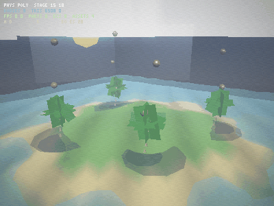
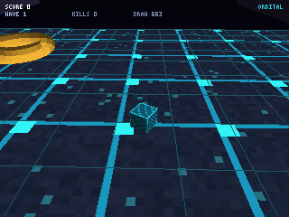
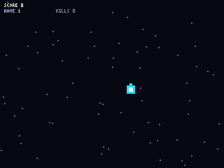
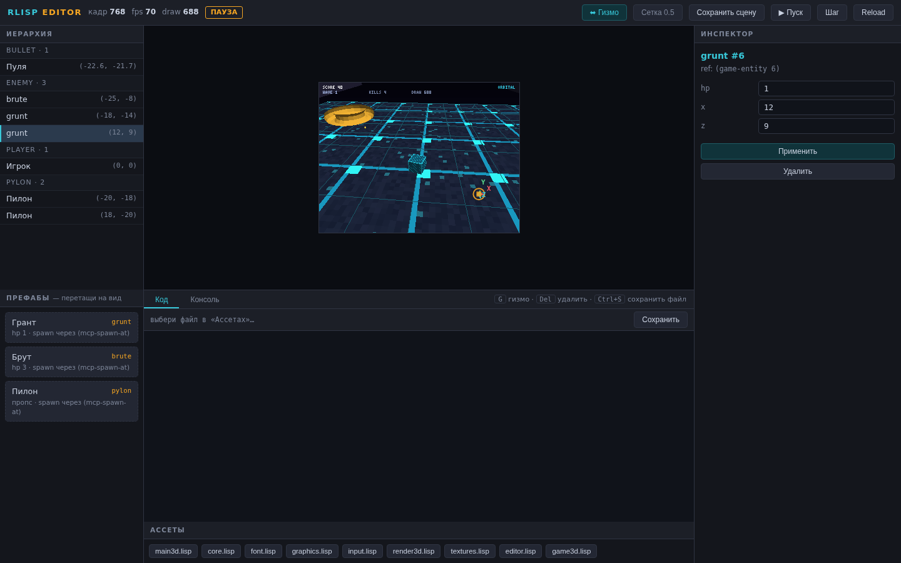
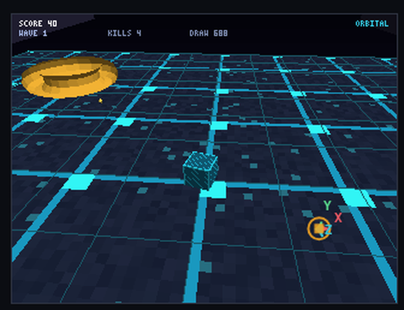
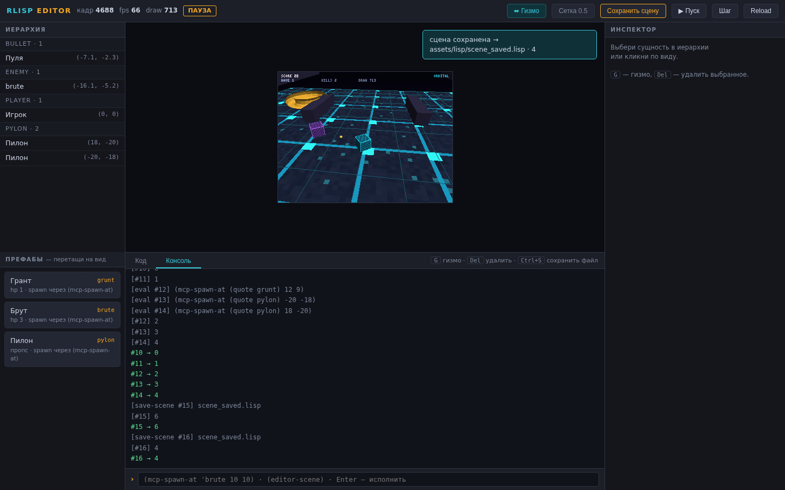
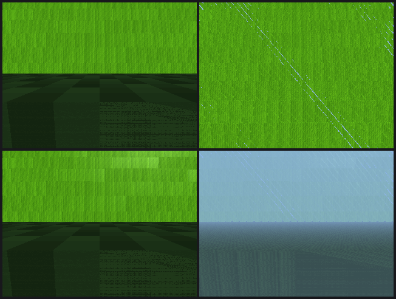
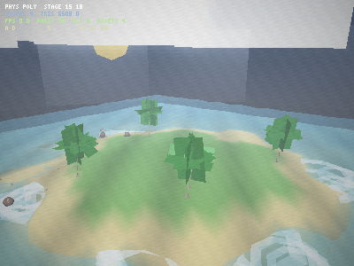

# rlisp-engine

[](https://github.com/kostyk348/rlisp-engine/actions/workflows/ci.yml)
[](https://github.com/kostyk348/rlisp-engine/releases)


[](https://github.com/kostyk348/rlisp-engine/actions/workflows/pages.yml)
[English](README.en.md) | Русский

**Игровой движок как Lisp-машина: Rust только как HAL, всё остальное — DSL.**
**Сайт:** [kostyk348.github.io/rlisp-engine](https://kostyk348.github.io/rlisp-engine/) · **Песочница в браузере:** [playground.html](https://kostyk348.github.io/rlisp-engine/playground.html) — весь движок в WASM, открывается как файл.

| | |
|---|---|
| 🚀 **JIT числовых ядер** | до **234×** на смешанном ядре (cond/let*/min/max/floor в машинный код), паритет с интерпретатором по битам |
| 🎱 **NGS-физика** | честное качение: трение в точке контакта с угловой связью, склоны без накачки энергии, побитовый детерминизм |
| 🦴 **Скелет + частицы** | иерархия костей → `gpu3d-batch-mat`; пул 4096 частиц с LCG-детерминизмом |
| 🧩 **ECS в ядре** | слоты+поколения (зомби-хендлы невозможны), bulk-запросы `ecs-each/col` |
| 📦 **Ассеты** | именованный реестр с типами и рефкаунтами, явная сборка `asset-gc!` |
| 🎬 **Пост-обработка** | bloom + экспозиция с плечом + виньетка + детерминированное зерно (~0.6 мс на 400×300) |
| 🌤️ **Атмосфера** | небодом + солнце в bloom, дрейфующие облака, blob-тени, глиттер воды — всё из Lisp |
| 🛠️ **Редактор + MCP** | гизмо в живой игре, hot reload, AI Ready (Model Context Protocol) |
| 🌐 **Песочница** | весь движок в ~1 МБ WASM: редактор, REPL, звук — ноль сети после загрузки |



Прототип по [ТЗ v1.0](#): движок не содержит игровых систем — он содержит только
доступ к «железу». Рендерер, физика, ECS, ввод, текстуры, редактор, MCP —
Lisp-библиотеки поверх тонкого Rust-слоя.

**v0.3 — текстуры, батч-вершинник, редактор аля Unity, AI Ready/MCP:**

- **Текстуры**: PNG-декодер без зависимостей (полный inflate: stored/fixed/dynamic
  Huffman), процедурные текстуры на Lisp (canvas на F32Vec), перспектива-корректный
  UV-семплинг (интерполяция `u/w` и `1/w`, клиппинг атрибутов вместе с вершиной);
- **Батч-вершинник**: сотни объектов одним draw call — 12 f32 на инстанс
  (translate/scale/yaw/pitch/roll/tint), T&L всех инстансов в узком Rust-цикле —
  **~3× ускорение** отрисовки против по-объектных вызовов;
- **Редактор аля Unity** (`--serve`): иерархия сцены, инспектор свойств, живой
  вид (PNG-стрим кадра), REPL, редактор кода ассетов с hot reload — весь UI
  общается с движком через Lisp (`editor.lisp`);
- **AI Ready / MCP** (`--mcp`): Model Context Protocol (JSON-RPC 2.0, stdio) —
  ИИ-агент видит сцену, спавнит сущности, правит свойства, исполняет Lisp,
  шагает симуляцию и **получает скриншоты** движка.

**v0.4 (этапы 3/5/6 роадмапа):** copy-and-patch JIT числовых ядер (49×,
zero-dep) + SIMD-токенизатор; свежие демо-гифки и benchmark.md; редактор
стал «нормальным»: **гизмо X/Y-Z двигают сущности в живой игре,
drag-n-drop префабов, сохранение сцены в Lisp-файл** (страница редактора
пересобрана — на master она была битой с первого коммита).

```
┌──────────────────────────────────────────────────────────────────────┐
│  УРОВЕНЬ 4: Игровые DSL (жанровые)                                   │
│  (defgame survival …) (defenemy grunt …)       «ORBITAL» (game3d.lisp)│
├──────────────────────────────────────────────────────────────────────┤
│  УРОВЕНЬ 3: Системные DSL — всё на Lisp (assets/lisp/)               │
│  graphics │ input │ ecs │ physics │ render3d │ textures │ editor     │
├──────────────────────────────────────────────────────────────────────┤
│  УРОВЕНЬ 2: Lisp-интерпретатор + SAL (src/interp.rs, src/simd.rs)    │
│  Reader │ Evaluator (TCO) │ defmacro/quasiquote │ F32Vec │ GC      │
├──────────────────────────────────────────────────────────────────────┤
│  УРОВЕНЬ 1: Rust HAL (src/hal.rs, render3d.rs, png.rs, editor.rs,    │
│  mcp.rs, json.rs) — окно/растр │ 3D-«GPU»: T&L+текстуры+батчи+       │
│  z-буфер │ ввод │ память │ время │ PNG-кодек │ HTTP │ MCP            │
└──────────────────────────────────────────────────────────────────────┘
```

## Быстрый старт

```bash
cargo build --release

# 3D-демо «ORBITAL» (без экрана — кадры PNG):
./target/release/rlisp-engine --script assets/lisp/main3d.lisp \
    --capture demo/frames3d --every 12 --frames 240 --fast

# играть в 3D в терминале (ANSI, wasd, q — выход):
./target/release/rlisp-engine --script assets/lisp/main3d.lisp --ascii --stdin-keys

# РЕДАКТОР аля Unity (браузер): иерархия · инспектор · вид · REPL · ассеты
./target/release/rlisp-engine --serve --port 7300 --script assets/lisp/main3d.lisp
#   → открой http://127.0.0.1:7300
bash scripts/demo_editor.sh          # то же, одной командой

# AI READY: MCP-сервер (JSON-RPC 2.0 поверх stdio) — подключи любого ИИ-агента
./target/release/rlisp-engine --mcp --script assets/lisp/main3d.lisp

# 2D-демо «Выживание»:
./target/release/rlisp-engine --ascii --stdin-keys

# бенчмарк SIMD-слоя: ./target/release/rlisp-engine --bench
# проверки (TCO, макросы, текстуры, батчи, PNG-кодек): bash scripts/smoke.sh

# ДЕМО HOT RELOAD: на 9-й секунде правит game3d.lisp на лету:
bash scripts/demo3d.sh   # → demo/orbital.gif + demo/filmstrip3d.png
```

## Рендер-бэкенды (этап 1 роадмапа)

За фасадом HAL — два бэкенда с одним профилем API (`gpu-clear` /
`gpu-fill-rect` / `gpu-blit` / `gpu-blit-tex` / `gpu-present`), Lisp-код
один и тот же:

| Бэкенд | Как включить | Что делает |
|---|---|---|
| **программный растр** (дефолт) | ничего; ноль зависимостей | команды пишут прямо в фреймбуфер |
| **wgpu** | `cargo build --release --features wgpu` + флаг `--wgpu` | offscreen-рендер RGBA8 (WGSL-шейдер, nearest, discard alpha=0) → map-read → композит в фреймбуфер; без адаптера — предупреждение и откат на софт |

Бенчмарк кадра: `--bench` (софт) и `--bench --wgpu` (GPU, разбивка
submit/readback). Честно: wgpu закрывает 2D-растр, 3D-конвейер (T&L,
z-буфер, батчи) пока программный; критерий «wgpu кратно быстрее» требует
GPU-железа — `docs/benchmark.md` содержит только реальные замеры с метками
окружения. Подробности — `docs/architecture.md`, роадмап — `docs/roadmap.md`.

## Интерпретатор: cons-пары, tracing-GC, фоновый MCP (этап 2 роадмапа)

**Критерии этапа — проверены** (тесты + `scripts/smoke.sh`):

| Критерий | Как проверен |
|---|---|
| `(cons 1 2)` | → `(1 . 2)`: unit-тест, smoke-строка, `--eval`; `car`/`cdr`/`set-car!`/`set-cdr!`/`cons?`/`pair?`/`list?`/`length`/`append`/`reverse`/`nth`/`apply` работают и с парами, и с Vec-списками; печать стандартная `(a b c)` / `(a . b)`, циклы печатаются как `(1 …)` без зависания |
| 1000 циклов замыканий | тест гоняет 1000 итераций «построил пару замыканий, захватывающих друг друга через окружение → снял корень → собрал»: живых объектов в GC-куче ровно базовая линия на каждом круге (освобождено ≥ 3000 объектов) |
| MCP не крашит игру | тест-молотилка: 120 инструментов (eval/spawn/step/screenshot/…) от фонового потока поверх живой игры 3D — все отвечены, ноль паник; smoke: 102 запроса по stdio |

- **Пары**: `cons` строит cons-ячейку (`Value::Cons`), Vec-списки никуда не
  делись — представления сосуществуют; reader читает `(a . b)` и
  `(lambda (a . rest) …)`, quasiquote проходит через пары.
- **GC**: tracing mark-sweep (`src/gc.rs`, ноль зависимостей) для пар,
  замыканий и окружений — арена объектов, хендлы (индекс+поколение) в
  `Value`, маркировка от корней (глобальное окружение, pin-наборы, очередь
  ввода). Сборка — на границах форм; `(gc)` просит сборку, `(gc-stats)`
  показывает счётчики. Rc-контейнеры (векторы, таблицы, строки) остаются на
  Rc и прозрачны для маркировки; циклы «замыкание ↔ окружение» и циклы пар
  собираются, Rc-циклы через сами контейнеры — пока нет (честно — в
  `LIMITATIONS.md`).
- **Потоки**: MCP обслуживают фоновые потоки — reader разбирает stdio в
  mpsc-канал, игровая нить (единственный владелец интерпретатора) применяет
  запросы между кадрами, writer один печатает ответы. Потоки общаются только
  каналами — гонок по построению; `--mcp` поведение не изменилось.

## Демо

3D «ORBITAL» (v0.3): пол — процедурная текстура «неоновая схема» (один
текстурный draw call вместо сотен линий), враги/игрок — текстура «панель» с
тинтом, враги/пули/пилоны рисуются **батчами** (по одному draw call на группу).
На t=9с `game3d.lisp` правится на диске: враги становятся оранжевыми и вдвое
быстрее — без перезапуска (`demo/run3d.log`, «12 persistent-значений
восстановлено»). Гифки перезахвачены на текущем master (этап 5): 90 кадров /
18 с, 540 кадров симуляции без падений.



2D «Выживание» (v0.1, свежий захват этапа 5): 

Весь игровой код — Lisp (`assets/lisp/game.lisp`, `assets/lisp/game3d.lisp`):
игрок, волны, автоприцел, коллизии, счёт, GAME OVER + рестарт на `R`.

## Редактор аля Unity (--serve)

Ноль зависимостей: HTTP-сервер на `std::net`, страница редактора зашита в
бинарь (`assets/editor/index.html`). Игровая нить публикует кадр/сцену/лог в
мост (`src/editor.rs`), браузер опрашивает `/api/state` и `/frame.png`.



| Панель | Что умеет |
|---|---|
| **Иерархия** | живой список сущностей сцены — игрок, враги, пилоны, пули, эффекты; клик — выбор (клик по виду — тоже) |
| **Префабы (этап 6)** | чипы из хука игры `(prefab-list)` (grunt / brute / pylon); **drag-n-drop на вид** → обратная развёртка пикселя в луч → `(mcp-spawn-at 'kind x z)` — спавн в живой игре |
| **Инспектор** | свойства выбранной сущности; «Применить» исполняет `(table-set! REF 'prop value)` в живом мире |
| **Вид** | кадр движка PNG-стримом (~5 Гц), **гизмо X/Y/Z (этап 6)**: тяга оси мышью двигает сущность в живой игре, тумблер сетки 0.5, бейдж ПАУЗА |
| **Консоль + REPL** | любой Lisp в живом окружении: `(mcp-spawn-at 'brute 10 10)`, `(load "scene_saved.lisp")` → ответ в консоли |
| **Код** | ассеты (все .lisp файлы), правка, Ctrl+S → `/api/save` → **движок сам делает hot reload**, persistent-состояние переносится |
| **Тулбар** | пауза/шаг кадра/перезагрузка Lisp, кадр, fps, треугольники, **«Сохранить сцену» (этап 6)**, хоткеи: `G` — гизмо, `Del` — удалить выбранное |

### Сохранение сцены в Lisp (этап 6)

Кнопка «Сохранить сцену» → `POST /api/save-scene` → игровая нить вызывает
`(editor-save-scene "scene_saved.lisp")` (editor.lisp) и сериализует живую
сцену в формы восстановления:

```lisp
;; scene_saved.lisp — сцена, сохранённая редактором rlisp-engine.
(begin (table-set! *player* 'x 0.0) (table-set! *player* 'z 0.0))
(mcp-spawn-at 'grunt -18 -14)
(mcp-spawn-at 'brute -25 -8)
(mcp-spawn-at 'pylon 18 -20)
```

Возврат в игру — `(load "scene_saved.lisp")` через REPL. Round-trip
покрыт unit-тестом: 3 сущности → файл → reader → load → те же сущности
и позиции.




API (им же пользуется любой скрипт/агент):

```
GET  /                 страница редактора      GET  /frame.png      текущий кадр
GET  /api/state        сцена+лог+результаты    GET  /api/file?path= текст ассета
                       + камера и префабы игры
                       (хуки editor-camera /
                       prefab-list, этап 6)
POST /api/eval {code}  исполнить Lisp          POST /api/save       сохранить ассет
POST /api/key {key,down} клавиша в игру        POST /api/ctl {cmd}  pause|resume|step|reload
POST /api/save-scene {path} сериализация сцены в Lisp-файл (этап 6)
```

Сцена для иерархии — Lisp: `(editor-scene)` (editor.lisp) вызывает хук игры
`(scene-entities)` (game3d.lisp) — таблицы превращаются в JSON нативно
(`src/json.rs`, HAL-уровень). Камера гизмо и префабы — так же: хуки
`(editor-camera)` и `(prefab-list)`, нет хука — редактор честно прячет
инструмент.

## AI Ready: MCP (--mcp)

Model Context Protocol, JSON-RPC 2.0 поверх stdio — стандарт для инструментов
ИИ (Claude Desktop, любые MCP-клиенты). Протокольная обвязка — Rust
(`src/mcp.rs`), семантика инструментов — Lisp (editor.lisp + хуки игры).

| Инструмент | Что делает |
|---|---|
| `status` | кадры, fps, счёт, волна, враги, draw calls, SIMD-уровень |
| `scene_get` | сцена JSON: игрок/враги/пули с координатами |
| `lisp_eval` | **полный доступ**: любой код Lisp в живом окружении |
| `entity_spawn` / `entity_set` / `entity_remove` | операции над сущностями |
| `step {frames}` | прошагать симуляцию (до 600 кадров) |
| `screenshot` | **PNG кадра (base64, image content)** — агент видит игру |
| `hot_reload` | перечитать .lisp (состояние defpersistent переносится) |
| `key` | событие клавиатуры |

Пример сессии:

```
→ {"jsonrpc":"2.0","id":1,"method":"initialize","params":{}}
← {"result":{"protocolVersion":"2024-11-05","serverInfo":{"name":"rlisp-engine","version":"0.3.0"}}}
→ {"id":2,"method":"tools/call","params":{"name":"step","arguments":{"frames":90}}}
← {"result":{"content":[{"text":"выполнено 90 кадров (102.9 fps headless)"}]}}
→ {"id":3,"method":"tools/call","params":{"name":"screenshot"}}
← {"result":{"content":[{"type":"image","data":"iVBORw0KGgo…","mimeType":"image/png"}]}}
```

## 3D-конвейер (v0.2 → v0.3)

Разделение труда — то же, что между CPU и GPU:

| Слой | Что делает |
|---|---|
| **Rust `render3d.rs`** («железо», fixed-function) | T&L (model·view·proj), Sutherland–Hodgman по near-плоскости **вместе с UV-атрибутами**, backface cull, растеризация с z-буфером, flat-затенение Ламберта, **текстурирование: перспектива-корректный UV** (`u/w`, `1/w` — аффинны в экранном пространстве), **батч: развёртка инстансов в общие буферы + одна растеризация**, DDA-линии |
| **Lisp `render3d.lisp`** (пайплайн) | матрицы 4×4, `mat-lookat`, `mat-perspective`, модели, примитивы (куб/UV-сфера/тор/октаэдр/плоскость), `camera-mvp`, `draw-mesh`, **`draw-batch`/`draw-batch-tex`, `inst-row` (12 f32: t·s·yaw·pitch·roll·tint)** |
| **Lisp `textures.lisp`** (v0.3) | `tex-canvas`/`tex-px!` — процедурные текстуры (`tex-circuit`, `tex-panel`, `tex-checker`, `tex-noise`, `tex-gradient`), `load-texture` (PNG), UV-развёртки примитивов, `draw-sprite` 2D |
| **Lisp `game3d.lisp`** (сцена/игра) | камера за игроком, спавн, погоня, пули, FX, HUD, хуки редактора |

HAL-нативы 3D — «сырые команды GPU»:

| Натив | Сигнатура |
|---|---|
| `gpu3d-clear` | `(gpu3d-clear r g b)` |
| `gpu3d-light` | `(gpu3d-light dx dy dz ambient [diffuse [spec [shininess]]])` — опц. блик (этап 7) |
| `gpu3d-mesh` | `(gpu3d-mesh pos idx model mvp r g b)` |
| `gpu3d-mesh-tex` | `(gpu3d-mesh-tex pos uv idx tex model mvp r g b)` |
| `gpu3d-batch` | `(gpu3d-batch pos idx insts mvp)` — инстансы: 12 f32 |
| `gpu3d-batch-tex` | `(gpu3d-batch-tex pos uv idx tex insts mvp)` |
| `gpu3d-alpha-test` | `(gpu3d-alpha-test threshold)` — cutout, 0 = выкл (этап 7) |
| `gpu3d-mat-tiling` | `(gpu3d-mat-tiling u v)` — repeat UV (этап 7) |
| `gpu3d-fog` | `(gpu3d-fog r g b density)` — exp-туман по глубине (этап 7) |
| `gpu3d-view` | `(gpu3d-view x y z)` — камера для блика (этап 7) |
| `gpu3d-state` | `(gpu3d-state)` — таблица состояния конвейера (этап 7) |
| `gpu3d-wire` | `(gpu3d-wire pos pairs model mvp r g b)` |
| `gpu3d-stats` | `(gpu3d-stats)` → `(нарисовано отброшено)` |

Текстуры HAL: `texture-load` (PNG с диска), `texture-upload` (RGBA из
Lisp-буфера), `texture-size`, `texture-pixels`, `texture-free`, `gpu-blit-tex`
(2D-спрайт с тинтом). PNG-кодек (`src/png.rs`) — свой: писатель (stored
deflate) + **читатель** (полный RFC 1951 inflate + фильтры 0–4, цветовые типы
0/2/3/4/6).

Один кадр «ORBITAL» v0.3 ≈ **7–9 draw calls 3D** (v0.2: 60–80), ~700–800
треугольников, 320×240 — **~100 fps** headless на тестовой VM (в кадре
текстурный растр — дороже попиксельно, чем flat). Замер батча: 30 кубов × 60
повторов — **батч 13.0 мс против 39.5 мс по-объектно (3.0×)**.

## Материалы, свет, туман (этап 7)

Программный 3D-«GPU» дополнен материалами в духе fixed-function —
фундамент «крышесносной» демо-сцены (материалы/вода/деревья):

- **alpha-test (cutout)** — `(gpu3d-alpha-test 0.4)`: тексель с alpha ниже
  порога отбрасывается **до записи в z-буфер** — сквозь прорези травинок и
  дырки заборов видна сцена, полупрозрачности в 3D нет (честно);
- **блик Blinn-Phong** — `(gpu3d-light dx dy dz ambient diffuse 0.6 48)` +
  `(gpu3d-view x y z)`: per-pixel half-vector на перспективно-корректной
  мировой позиции; spec 0 — прежний Lambert;
- **тайлинг** — `(gpu3d-mat-tiling 16 16)`: repeat текстуры через fract
  (земля/стены без растяжения);
- **туман** — `(gpu3d-fog 0.55 0.7 0.9 0.045)`: `1 - exp(-density·глубина)`
  по истинной глубине 1/w, смешение после шейдинга;
- **материалы на Lisp** (`assets/lisp/materials.lisp`, грузится main3d):

```lisp
(defmaterial 'кусты ':texture tex ':alpha-test 0.4 ':spec 0.6 ':shininess 48)
(draw-batch-tex mesh uv tex insts mvp 'кусты)  ; материал последним аргументом
(material-reset!)                              ; нейтральное состояние
```

Визуальное доказательство — `bash scripts/materials_proof.sh`
(4 варианта одной сцены, PIL-сверка пикселей):



Стоимость материалов — реальные замеры `--bench` (та же сцена, 320×240):
блик +46%, туман +15%, alpha-test +4%, всё вместе **+59% к базовому кадру
Lambert** — окружение и разброс в `docs/benchmark.md`.

## Hot reload (ТЗ §8)

Ядро следит за `.lisp`-файлами каждый кадр. При изменении: из старого мира
снимается `*persistent*`-состояние (12 значений в 3D), строится новое
Lisp-окружение, все файлы перечитываются, значения переносятся. Работает и из
редактора (Ctrl+S в вкладке «Код»), и по MCP (`hot_reload`). Проверено:
`demo/run3d.log` (кадр 255), лог редактора (кадр 1124/5462).

## SIMD-слой (SAL, ТЗ §4.3–4.5)

`src/simd.rs`: AVX-512 → AVX2 → SSE2 → скаляр, runtime-диспетчеризация +
калибровка micro-kernel на старте. `--bench`: vec-dot 2048 f32 — 4.1×;
интеграция 400 тел через `vec-add` — ~1100× против поэлементного Lisp
(горячие данные — плотные `F32Vec`, интерпретатор в цикле не участвует).

## Что реализовано (сверка с ТЗ)

| Фаза ТЗ | Статус | Артефакт |
|---|---|---|
| Фаза 0: свой интерпретатор | ✅ | полный контроль над макросами/TCO |
| Фаза 1: HAL окно+GPU | ✅* | программный растр с профилем API wgpu |
| Фаза 2: ввод/время/память/SIMD | ✅ | `input-poll`, `time-now`, `mem-*`, `vec-*` + тесты эквивалентности |
| Фаза 3: макросы, TCO, eval | ✅ | `defmacro`, quasiquote, замыкания, hot reload |
| Фаза 4: Graphics DSL | ✅* | `with-frame`, `draw-text`; **v0.3: текстуры и спрайты** |
| Фаза 5: ECS + Physics DSL | ✅ | `defcomponent/defsystem`, `aabb-collide?`, SIMD-интеграция |
| Фаза 6: Game Loop + демо | ✅ | `(defgame survival …)`, hot reload |
| 3D (v0.2) | ✅ | z-буфер, куллинг, flat-shading, «ORBITAL» на Lisp |
| **Текстуры (v0.3)** | ✅ | PNG-кодек, процедурные текстуры, перспектива-корректный UV |
| **Батч-вершинник (v0.3)** | ✅ | `gpu3d-batch[-tex]`, 12 f32/инстанс, ~3× |
| **Редактор (v0.3)** | ✅ | `--serve`: иерархия, инспектор, REPL, ассеты, вид |
| **AI Ready/MCP (v0.3)** | ✅ | `--mcp`: 10 инструментов, скриншоты, stdio JSON-RPC |
| **JIT + SIMD-токенизатор (этап 3)** | ◐ | JIT числовых ядер 49× (zero-dep copy-and-patch), деопт; парсер ≥3× не достигнут (1.07×) — `docs/benchmark.md` |
| **Демо (этап 5)** | ◐ | свежие гифки 2D/3D, 540 кадров без падений, benchmark.md; «3D на wgpu» — ожидает GPU-железа |
| **Редактор этап 6** | ◐ | гизмо X/Y/Z в живой игре, drag-n-drop префабов, «Сохранить сцену» → .lisp; оговорки — `docs/roadmap.md` |

`*` — отличие от ТЗ (осознанное для прототипа): вместо `wgpu` — программный
растр с тем же профилем API. wgpu-бэкенд подключается за тем же фасадом HAL,
Lisp-уровень не изменится.

## Честные отличия и ограничения прототипа

- **Рендер**: софтверный фреймбуфер по умолчанию; wgpu-бэкенд — за фичей
  `wgpu` (этап 1 роадмапа), headless через offscreen+readback. На GPU-железе
  не проверялся (в песочнице нет адаптера).
- **3D**: flat-затенение, Ламберт; текстуры — nearest-семплинг (без мипов и
  фильтрации); клиппинг — только near-плоскость (камеру не приближать вплотную
  к геометрии); прозрачность — только в 2D-спрайтах (альфа-блинт), в 3D нет
  сортировки прозрачного.
- **Редактор**: одностраничный; гизмо — 2D-оверлей над PNG-стримом (~4–5 Гц,
  камера движется — оверлей чуть отстаёт, тяга компенсирует якорем старта);
  ось Y двигает свойство `y`, только если оно есть у сущности; drag-n-drop и
  клик-выбор работают в браузере; сохранение сцены — спавн-скрипт
  (восстановление добавляет сущности к текущим, без дедупликации), загрузка —
  ручная через REPL; вид — PNG-поллинг, не видеопоток; сервер слушает только
  127.0.0.1.
- **MCP**: tools, resources/prompts не реализованы; протокол — в фоновых
  потоках (этап 2), интерпретатор — однопоточный владелец состояния;
  симуляция идёт, когда агент вызывает `step` (это же честный headless-режим).
- **Списки и GC**: cons-пары + Vec-списки сосуществуют; GC — tracing
  mark-sweep для пар/замыканий/окружений (этап 2), сборка на границах форм;
  Rc-контейнеры (векторы/таблицы) прозрачны для маркировки, но Rc-циклы
  через сами контейнеры не собираются.
- **Потоки/аудио**: MCP — reader/writer-потоки с каналами (этап 2);
  интерпретатор — однопоточный владелец Lisp-состояния; аудио не реализовано.
- **Текстуры и hot reload**: процедурные текстуры создаются при каждой
  перезагрузке мира заново; с этапа 1 менеджер GPU-ресурсов освобождает
  старые текстуры при reload (утечка «64 КБ/текстуру» из v0.3 устранена).

## Структура

```
src/
  main.rs      ядро: игровой цикл, hot reload, режимы (--serve/--mcp/--bench/--wgpu)
  interp.rs    Lisp: reader (+точечные пары), eval+TCO, макросы, замыкания,
               cons-пары, таблицы, F32Vec
  gc.rs        этап 2: tracing-GC — арена Pair/Lambda/Env, mark-sweep,
               pin-корни, (gc)/(gc-stats)
  hal.rs       HAL: растр (фасад бэкендов), ввод, память, файлы, время (+ реестр текстур)
  gpu.rs       этап 1: бэкенды рендера (software | wgpu), менеджер GPU-ресурсов
  render3d.rs  «GPU»: T&L, near-clip (+UV), куллинг, z-буфер, текстурирование,
               батч-вершинник, линии
  editor.rs    v0.3: HTTP-сервер редактора (std::net), мост кадр/сцена/команды;
               этап 6: камера/префабы в /api/state, /api/save-scene
  mcp.rs       v0.3: MCP-сервер (JSON-RPC 2.0, stdio), 10 инструментов;
               этап 2: reader/writer-потоки + mpsc, interp — на игровой нити
  json.rs      v0.3: JSON-парсер/сериализатор (+ Value↔Json для сцены)
  simd.rs      SAL: AVX-512/AVX2/SSE2/scalar + калибровка + mat4-нативы
  png.rs       PNG-кодек: писатель (stored) + читатель (полный inflate)
build.rs       cfg has_avx512 по версии rustc (stdarch AVX-512 стабилен с 1.89)
assets/lisp/
  core.lisp      базовая библиотека: defpersistent, dotimes, get-kv…
  font.lisp      шрифт 3×5 как данные
  graphics.lisp  with-frame, draw-text (уровень 3)
  input.lisp     key-down?/key-pressed? (уровень 3)
  ecs.lisp       defcomponent/defsystem/entities (уровень 3)
  physics.lisp   aabb-collide?, integrate-batch! (уровень 3)
  render3d.lisp  3D-DSL: матрицы, камера, меши, draw + батчи (уровень 3)
  textures.lisp  v0.3: процедурные текстуры, PNG, UV, спрайты (уровень 3)
  editor.lisp    v0.3: мост редактора/MCP: editor-scene, mcp-* (уровень 3)
  game.lisp      игра «Выживание» (уровень 4)
  game3d.lisp    3D-игра «ORBITAL» + хуки сцены (уровень 4)
  main.lisp      бутстрап 2D-стека
  main3d.lisp    бутстрап 3D-стека
assets/editor/index.html   страница редактора (зашита в бинарь)
scripts/       smoke.sh, demo3d.sh, demo_hot_reload.sh, demo_editor.sh, …
demo/          orbital.gif, survival.gif, filmstrip*.png, editor-*.png, *.log
```

## Дальше

1. ~~wgpu-бэкенд за текущим фасадом HAL (Lisp не меняется)~~ — сделано в
   этапе 1 (2D-растр; 3D-батчи — этап 5, см. `docs/roadmap.md`).
2. ~~Редактор: гизмо-манипуляторы в виде (drag по осям), drag-n-drop
   префабов, сохранение сцены в Lisp-файл~~ — сделано в этапе 6
   (см. «Редактор аля Unity» и `docs/roadmap.md`).
3. 3D: мип-фильтрация текстур, прозрачность с сортировкой, фрустум-клиппинг
   по X/Y, скелетная анимация поверх `mat4-batch`.
4. MCP: resources (лог движка как поток), события сцены (on-kill и т.п.).
5. SIMD-токенизатор парсера — сделан в этапе 3, но критерий ≥3× не достигнут
   (1.07×, разбор в `docs/benchmark.md`); план лечения: интернирование
   символов, pshufb-классификация.
6. JIT для eval (ТЗ §10.1) — числовые ядра сделаны в этапе 3 (49×);
   расширение покрытия — следующий шаг.

## Этапы 19–20 (v0.14): пост-обработка и атмосфера

- **Пост-обработка** (`src/post.rs`): `gpu3d-post` — bloom (сбор ИЗБЫТКА над
  порогом 0.86 → downsample ¼ → два box-blur → возврат ×3), экспозиция с
  мягким плечом (identity до 0.85 — средние тона сцены не искажаются),
  виньетка, зерно через хэш (пиксель, кадр) — детерминизм без rand.
  ~0.6 мс на 400×300 (release). 6 тестов, включая побитовый детерминизм.
- **Атмосфера** (Lisp над существующими нативами): небодом с sqrt-градиентом
  и диффузом 0 на время неба, солнце-диск (bloom-ореол), дрейфующие
  облака-билборды с процедурной текстурой (значения 0..255 — texel-альфа
  сэмплер не берёт, силуэт решён радиальным спадом), blob-тени под телами
  (масштаб от высоты), глиттер воды с предвычисленными базами (половина
  вершин за кадр), шум травы. Цена: ~27% fps — задокументирована в
  benchmark.md с A/B-протоколом.



## Этапы 15–18 (v0.13): JIT-покрытие, скелет, прокачанное ECS, ассеты

- **JIT**: расширение компилятора — `cond` (цепочка клаузов с else),
  `let*` (последовательные привязки), `min`/`max` (свёртка),
  `abs`/`sqrt`/`floor` как формы → машинный код (roundsd, sqrtsd, minsd/maxsd).
  Свойственный тест: 3000 случайных выражений — паритет с интерпретатором
  по битам; смешанное ядро — **≈234×** (20059 → 86 нс/вызов).
- **Скелет**: `src/skel.rs` — кости с эйлерами (тот же порядок, что у
  инстансов батча), композиция parent·local, `skel-matrices!`/`skel-batch!`
  → новый натив `gpu3d-batch-mat` (готовая матрица 4×4 + цвет на инстанс).
  В сцене кроны пальм гнутся под ветром (28 костей).
- **ECS**: `ecs-each` (bulk-строки [хендл, значения…]), `ecs-col` (проекция),
  `ecs-clear!`, `ecs-stats`.
- **Ассеты**: `src/assets.rs` — реестр с типами и рефкаунтами: put!/ref!/
  release!/gc!, typed-get, переиспользование слотов после явной сборки.

## Физика: NGS-солвер, ECS в ядре, частицы (этапы 12–14, v0.12)

- **Качение честно**: солвер — последовательные импульсы с накоплением
  (8 итераций): трение в точке контакта связывает скольжение и спин
  (|jt| ≤ μ·jn_нак), restitution — от центрального сближения, позиционная
  коррекция с потолком. Тесты: переход скольжения в качение (vx = v/1.4),
  отсутствие накачки энергии на склоне (проверка на каждый кадр),
  побитовый детерминизм с вращением.
- **ECS в ядре** (`src/ecs.rs`): слоты + поколения (зомби-хендлы
  невозможны), O(1) доступ, детерминированные `ecs-query` по компонентам.
  Lisp-уровень `ecs.lisp` остаётся DSL.
- **Частицы** (`src/particles.rs`): CPU-пул 4096, LCG-разброс залпов
  (детерминизм побитовый), `part-dump!` отдаёт плоский буфер — сцена
  собирает инстансы сама. Брызги песка/воды в «Физполигоне».
- 85/85 тестов; см. `CHANGELOG.md` и честные ограничения в `LIMITATIONS.md`.

## Песочница в браузере (этап 10)

docs/playground.html — **движок целиком в WASM** (интерпретатор + софт-рендер
+ физика, ~0.7 МБ inline): редактор Lisp с пресетами, REPL, звук ударов
физики через WebAudio, ноль сети после загрузки. Пресет «Физполигон» —
кокосы, прыгающие по острову с водой, на нативах phys-* (см. src/physics.rs:
сферы + heightfield + плавучесть, импульсный солвер, 9 юнит-тестов).

## Демо: Остров (этап 9, ревизия 5 — сканлайн + векторный ALU)

Сцена assets/lisp/island.lisp. Новое против ревизии 4:
- **инкрементальный сканлайн-растеризатор** (opaque): спан пикселей
  строки из полулиний edge-функций вместо перебора bbox, пошаговые
  атрибуты с инвариантным знаменателем-площадью, z-тест до атрибутов;
  покрытие пикселей побитово совпадает с прежним перебором (юнит-тесты);
- **LUT тумана** (257 узлов, линейная интерполяция) вместо exp() на
  пиксель;
- **векторный ALU движка** (`f32vec-op!` / `f32vec-strided-set!`):
  per-vertex вода (френель/пена/глубина, 841 вершина) считается десятком
  пакетных вызовов вместо ~30 000 интерпретируемых операций за тик;
- **чайки**: 7 птиц на орбитах вокруг острова — батч-квады с взмахом
  через roll-компоненту инстанса;
- сетки крупнее благодаря высвобожденному бюджету: **суша 69×69**
  (шаг 0.94), вода 29×29;
- `--width/--height` теперь задаёт и `*screen-w*`/`*screen-h*` сцены
  (HUD/небо строятся под реальный экран);
- баланс: **32 fps @ 320x240** headless (--fast) при 13.6k треугольников,
  **27 fps @ 400×300** (демка). Ревизия 4: 20–21 fps @ 11.2k;
  ревизия 3: 27–28 fps @ 3.4k;
- wgpu-путь починен и проверен: WGSL-шейдер компилировался naga со
  времён этапа 1 с ошибкой (`let _`), найдено запуском на SwiftShader;
  кадр `--wgpu` побитово совпадает с программным рендером.

